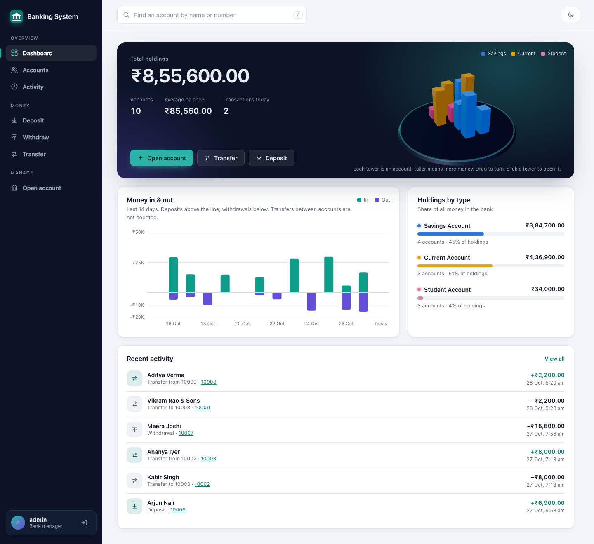
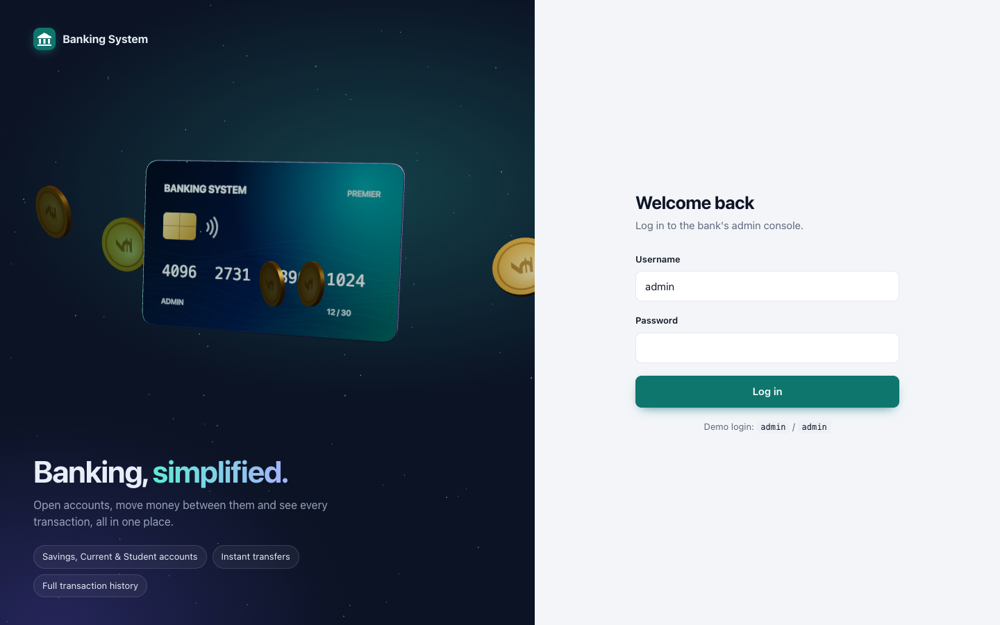
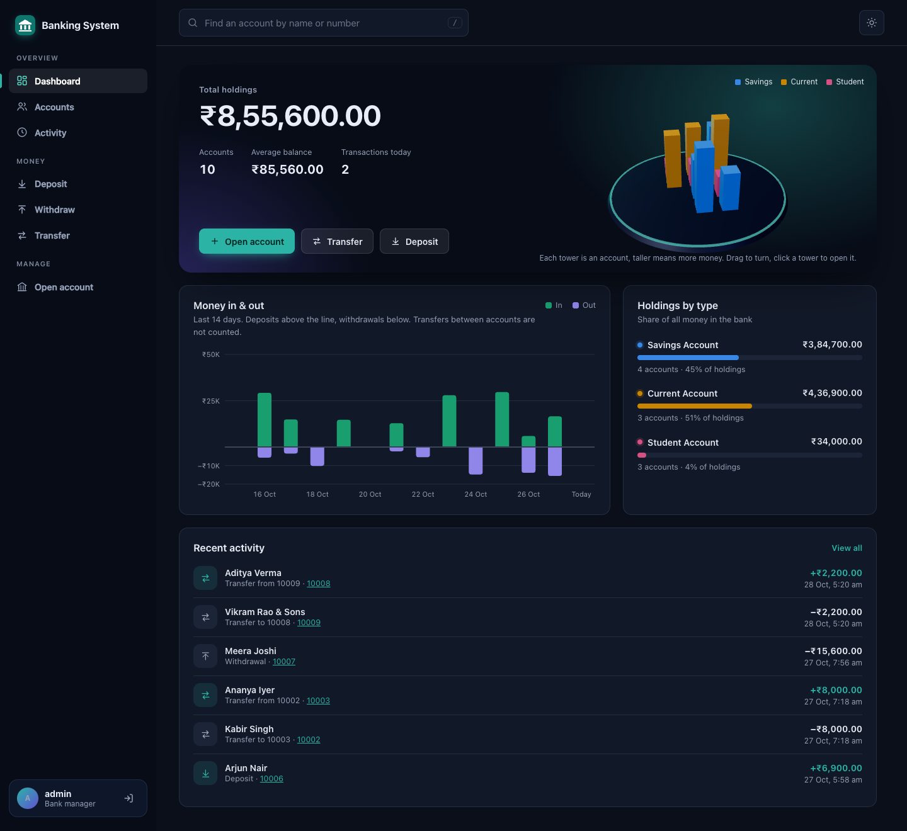
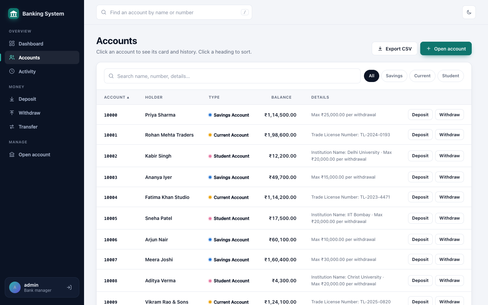
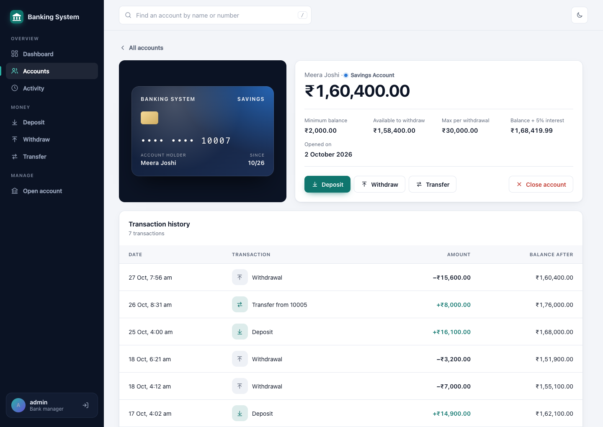
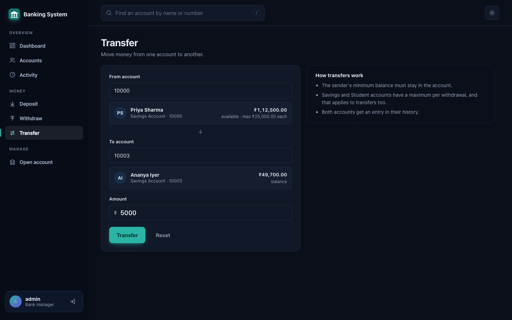
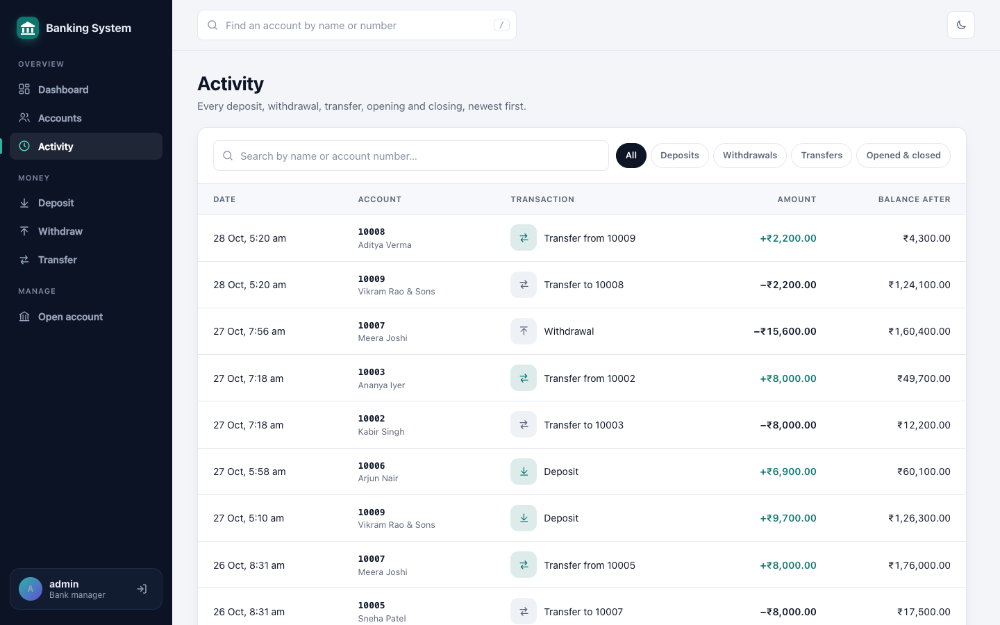
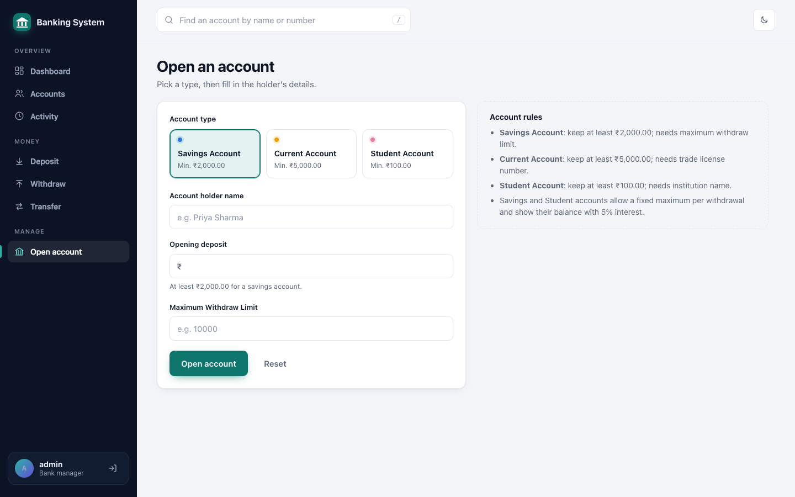
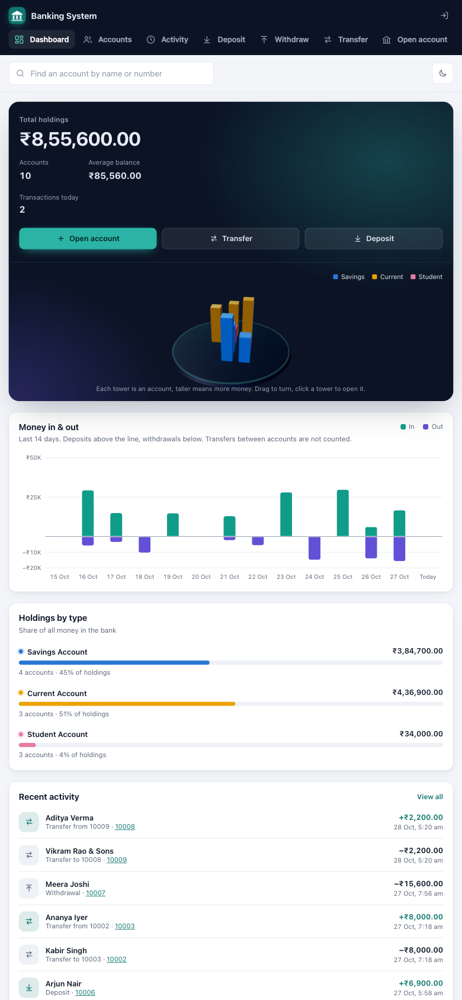
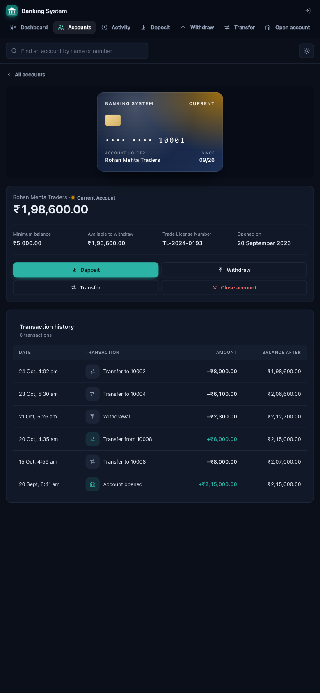

# Banking System

A bank management website with a Java backend. Bank staff can open Savings, Current and Student accounts, deposit, withdraw, transfer between accounts, close accounts and see the full history of every transaction. The backend is a small Java web server with no extra libraries, and the front end has a 3D login card and dashboard built with three.js.

**Live website:** https://java-project-3umo.onrender.com (free hosting: the first visit after a quiet spell takes about a minute to wake the server, and accounts are reset when it restarts)



## Features

- **Login** with an animated 3D bank card: it flies in, floats, flips to show its back, and can be dragged to spin or clicked to flip.
- **Dashboard**: total holdings, a 3D view with one tower per account (drag to turn, click to open), money in & out for the last 14 days, holdings by type and recent activity.
- **Accounts**: search, sort, filter by type and export to CSV.
- **Account page**: the account's card, balance, rules, a 5% interest projection for Savings and Student accounts, and its full history.
- **Open account** for all three types; the form asks for the right details for each type.
- **Deposit / Withdraw**: shows whose account it is, and how much can be taken out, while you type the number.
- **Transfer** between any two accounts; the sender's minimum balance and withdraw limit apply.
- **Close account**: pays out the remaining balance; the account number is never reused.
- **Activity**: every transaction in the bank, filterable by kind.
- Quick account search in the top bar (press `/`), light and dark theme, and a layout that works on phones.

Data is saved to the `data` file after every change.

### Account rules

| Account type | Minimum balance | Asked when opening | Max per withdrawal |
|---|---|---|---|
| Savings | ₹2,000 | Maximum withdraw limit | the limit given when opening |
| Current | ₹5,000 | Trade licence number | no limit |
| Student | ₹100 | Institution name | ₹20,000 |

A withdrawal or transfer can never take an account below its minimum balance.

## Running it on your computer

You need **Java 8 or newer** (`java -version`). Nothing else: the web server is built into the JDK and three.js is bundled in `web/vendor`.

```bash
git clone https://github.com/supremeinferno/java-project.git
cd java-project
```

**In VS Code (easiest):** open the folder with the *Extension Pack for Java*, pick **Banking Website** in the Run and Debug panel, and the browser opens by itself at http://localhost:8080.

**From a terminal**, in the project folder (so the `data` file and the `web` folder are found):

```bash
javac -d bin $(find src -name '*.java')
java -cp bin WebApplication          # http://localhost:8080
java -cp bin WebApplication 9000     # on another port
```

Log in with `admin` / `admin`, or the password set in `ADMIN_PASSWORD` (see below). `bin` is build output and is not kept in git.

> **Note:** always open the site through the Java server (http://localhost:8080). Opening `web/index.html` directly, or with VS Code's Live Server, shows an error page, because neither of them has the `/api` the site talks to.

## Deploying

The repo has a `Dockerfile` and a Render blueprint (`render.yaml`), so the website can run on any host that builds Docker images.

**On [Render](https://render.com) (free):** sign in with GitHub, choose **New > Blueprint**, pick this repo, enter an `ADMIN_PASSWORD` when asked, and click **Apply**. To change the password later, open the service's **Environment** tab, edit `ADMIN_PASSWORD` and save.

| Environment variable | Default | Meaning |
|---|---|---|
| `PORT` | `8080` | port to listen on (set by the host) |
| `HOST` | localhost only | `0.0.0.0` in the Docker image, so the site is reachable |
| `ADMIN_USER` / `ADMIN_PASSWORD` | `admin` / `admin` | login; **set a real password on a public server** |

On Render's free plan the disk is reset on every deploy or restart, so accounts made on the live site don't last. The free service also sleeps after 15 minutes without visitors.

## Screenshots

| Login (animated 3D card) | Dashboard, dark theme |
|---|---|
|  |  |
| **Accounts** | **Account page** |
|  |  |
| **Transfer** | **Activity** |
|  |  |
| **Open an account** | **On a phone** |
|  |   |

The screenshots use demo accounts.

## How it works

```
 Browser ──HTTP──▶ WebServer (src/Web) ──▶ Bank, BankAccount, Transaction (src/Bank) ──▶ FileIO (src/Data) ──▶ data file
   (web/)            JSON API                 banking rules                                  Java serialization
```

- **`src/Bank`** is the domain model. `Bank` keeps the accounts in a map, so there is no limit on how many there are, and records every change as a `Transaction`. `BankAccount` is the abstract base of `SavingsAccount`, `CurrentAccount` and `StudentAccount` (a kind of savings account). `AccountType` holds each type's label, minimum balance and extra field, so a new account type only needs an `AccountType` entry and a `BankAccount` subclass.
- **`src/Exceptions`** holds the checked exceptions the model throws: `AccNotFound`, `InvalidAmount`, `MaxBalance` (would go below the minimum balance) and `MaxWithdraw` (over the withdraw limit).
- **`src/Data/FileIO`** loads and saves the bank with Java serialization. It writes to a temporary file first, so a failed save never destroys the old data.
- **`src/Web/WebServer`** uses the JDK's built-in `com.sun.net.httpserver`. It serves the `web` folder and a small JSON API, and uses a session cookie after login. `WebApplication` starts it and, on your own computer, opens the browser.
- **`web`** is the front end, in plain HTML, CSS and JavaScript modules with no build step: `app.js` for the pages, `chart.js` for the money in & out chart and `scene3d.js` for the three.js scenes. On a computer without WebGL, the site still works, just without the 3D parts.

### API

| Method | Path | Form fields | Does |
|---|---|---|---|
| `POST` | `/api/login` | `username`, `password` | logs in and sets the session cookie |
| `POST` | `/api/logout` | | logs out |
| `GET` | `/api/types` | | account types and their rules |
| `GET` | `/api/bank` | | all accounts and all transactions |
| `POST` | `/api/accounts` | `type`, `name`, `balance`, `extra` | opens an account |
| `POST` | `/api/deposit` | `account`, `amount` | deposits |
| `POST` | `/api/withdraw` | `account`, `amount` | withdraws |
| `POST` | `/api/transfer` | `from`, `to`, `amount` | transfers |
| `POST` | `/api/close` | `account` | closes an account and pays out its balance |

Everything except login and types needs the session cookie. Errors come back as `{"error": "..."}` with status 400, 401 or 404.

## Project structure

```
├── src
│   ├── WebApplication.java    entry point
│   ├── Bank/                  domain model
│   ├── Data/                  saving and loading
│   ├── Exceptions/
│   └── Web/                   web server and API
├── web/                       the website (HTML, CSS, JS, bundled three.js)
├── screenshot/
├── Bank.pdf                   project report
├── Dockerfile, render.yaml    deployment
└── .vscode/launch.json        run configuration
```

## Project report

[Bank.pdf](Bank.pdf) is the project report: introduction, proposed system, feasibility analysis, design, modules and screenshots.

## Technologies

- Java 8+, with `com.sun.net.httpserver` for the web server
- HTML, CSS and JavaScript (ES modules)
- [three.js](https://threejs.org) r160 for the 3D scenes (MIT licence, bundled in `web/vendor/three`)
- Docker and Render for hosting

## Contribution

Contributions are welcome! If you'd like to contribute to the project, please follow these steps:

1. Fork the repository
2. Create a new branch (`git checkout -b feature/new-feature`)
3. Commit your changes (`git commit -m 'Add new feature'`)
4. Push to the branch (`git push origin feature/new-feature`)
5. Create a pull request

## License

This project is for educational purposes.

## Acknowledgments

- Java for the language and its built-in HTTP server.
- [three.js](https://threejs.org) for the 3D graphics.
