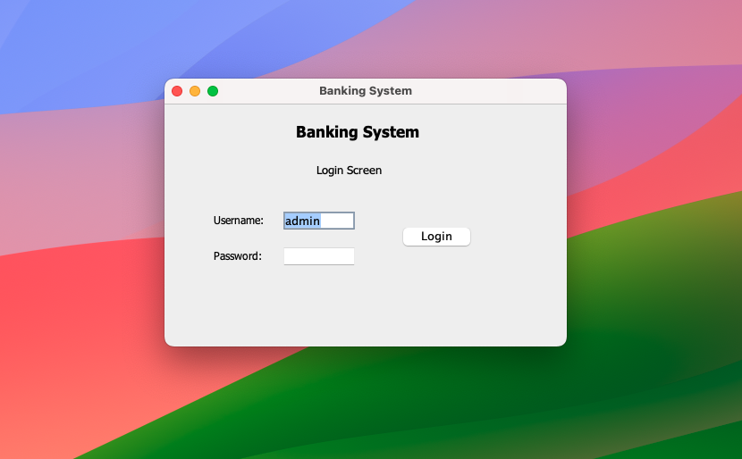

# Banking System

A bank management system written in Java. It runs two ways, both using the same Java classes and the same data file:

- a **Java Swing desktop app**, and
- a **website** served by a small Java web server, with a 3D login card and dashboard built with three.js.

**Live website:** https://java-project-3umo.onrender.com (free hosting: the first visit after a quiet spell takes about a minute to wake the server, and accounts are reset when it restarts)

Bank staff can open Savings, Current and Student accounts, deposit, withdraw, transfer between accounts, close accounts and see the full history of every transaction.


## Features

| | Desktop app (Swing) | Website |
|---|:---:|:---:|
| Admin login | ✓ | ✓ |
| Open Savings, Current and Student accounts | ✓ | ✓ |
| Deposit and withdraw | ✓ | ✓ |
| Searchable, sortable account list | ✓ | ✓ |
| Transfer between accounts | | ✓ |
| Close an account | | ✓ |
| Transaction history (per account and for the whole bank) | recorded | ✓ |
| Dashboard with totals, money in & out chart and 3D account view | | ✓ |
| Account page with card, details and 5% interest projection | | ✓ |
| Quick account search, CSV export, light / dark theme, phone layout | | ✓ |

Data is saved to the `data` file after every change, so nothing is lost between runs. Deposits and withdrawals made in the desktop app also show up in the website's history.

### Account rules

| Account type | Minimum balance | Asked when opening | Max per withdrawal |
|---|---|---|---|
| Savings | ₹2,000 | Maximum withdraw limit | the limit given when opening |
| Current | ₹5,000 | Trade licence number | no limit |
| Student | ₹100 | Institution name | ₹20,000 |

A withdrawal or transfer can never take an account below its minimum balance. Savings and Student balances are also shown with 5% interest.

## Getting started

You need **Java 8 or newer** (`java -version`). Nothing else: the web server is built into the JDK and three.js is bundled in `web/vendor`.

```bash
git clone https://github.com/supremeinferno/java-project.git
cd java-project
```

### In VS Code (easiest)

1. Open the project folder in VS Code (with the *Extension Pack for Java*).
2. In the **Run and Debug** panel pick:
   - **Banking Website**: the browser opens by itself at http://localhost:8080
   - **Banking App (Swing)**: the desktop app
3. Log in with username `admin`, password `admin`.

### From a terminal

Run these from the project folder, so the `data` file and the `web` folder are found:

```bash
javac -d bin $(find src -name '*.java') && cp -R src/img bin/

java -cp bin WebApplication          # website at http://localhost:8080
java -cp bin WebApplication 9000     # website on another port
java -cp bin Application             # desktop app
```

`bin` is build output and is not kept in git.

> **Note:** always open the website through the Java server (http://localhost:8080). Opening `web/index.html` directly, or with VS Code's Live Server, shows an error page, because neither of them has the `/api` the site talks to.

Don't run the desktop app and the website at the same time. Each keeps its own copy of the accounts in memory, and whichever saves last overwrites the other's changes.

## Deploying the website

The repo has a `Dockerfile` and a Render blueprint (`render.yaml`), so the website can run on any host that builds Docker images.

**On [Render](https://render.com) (free):** sign in with GitHub, choose **New > Blueprint**, pick this repo, enter an `ADMIN_PASSWORD` when asked, and click **Apply**. The site goes live at `https://banking-system-xxxx.onrender.com`.

| Environment variable | Default | Meaning |
|---|---|---|
| `PORT` | `8080` | port to listen on (set by the host) |
| `HOST` | localhost only | `0.0.0.0` in the Docker image, so the site is reachable |
| `ADMIN_USER` / `ADMIN_PASSWORD` | `admin` / `admin` | login; **set a real password on a public server** |

On Render's free plan the disk is reset on every deploy or restart, so accounts made on the live site don't last. The free service also sleeps after 15 minutes without visitors, and the first visit afterwards takes about a minute to wake it.

## Screenshots

### Website

| Login (animated 3D card) | Dashboard, dark theme |
|---|---|
|  |  |
| **Accounts** | **Account page** |
|  |  |
| **Transfer** | **Activity** |
|  |  |
| **Open an account** | **On a phone** |
|  |   |

The login card flies in, floats, flips over to show its back every few seconds, and can be dragged to spin or clicked to flip. The website screenshots use demo accounts.

### Desktop app

| Login | Menu |
|---|---|
|  |  |

## How it works

```
                ┌───────────────────── Java ─────────────────────┐
 Swing windows ─┤                                                │
   (src/GUI)    │   Bank, BankAccount, Transaction   FileIO      │── data file
                │   (src/Bank)                       (src/Data)  │
 Browser ─HTTP──┤   WebServer (src/Web)                          │
   (web/)       └────────────────────────────────────────────────┘
```

- **`src/Bank`** is the domain model and has no GUI code. `Bank` keeps the accounts in a map, so there is no limit on how many there are, and records every change as a `Transaction`. `BankAccount` is the abstract base of `SavingsAccount`, `CurrentAccount` and `StudentAccount` (a kind of savings account). `AccountType` holds each type's label, minimum balance and extra field.
- **`src/Exceptions`** holds the checked exceptions the model throws: `AccNotFound`, `InvalidAmount`, `MaxBalance` (would go below the minimum balance) and `MaxWithdraw` (over the withdraw limit).
- **`src/Data/FileIO`** loads and saves the bank with Java serialization. It writes to a temporary file first, so a failed save never destroys the old data.
- **`src/GUI`** holds the Swing windows. One `AccountForm` serves every account type and one `TransactionForm` serves both deposit and withdraw, so a new account type only needs an `AccountType` entry and a `BankAccount` subclass.
- **`src/Web/WebServer`** uses the JDK's built-in `com.sun.net.httpserver`. It serves the `web` folder and a small JSON API, listens on localhost only, and uses a session cookie after login. `WebApplication` starts it and opens the browser.
- **`web`** is the website, in plain HTML, CSS and JavaScript modules with no build step: `app.js` for the pages, `chart.js` for the money in & out chart and `scene3d.js` for the three.js scenes. On a computer without WebGL, the site still works, just without the 3D parts.

### API

| Method | Path | Form fields | Does |
|---|---|---|---|
| `POST` | `/api/login` | `username`, `password` | logs in and sets the session cookie |
| `POST` | `/api/logout` | | logs out |
| `GET` | `/api/types` | | account types and their rules |
| `GET` | `/api/bank` | | all accounts and all transactions |
| `POST` | `/api/accounts` | `type`, `name`, `balance`, `extra` | opens an account |
| `POST` | `/api/deposit` | `account`, `amount` | deposits |
| `POST` | `/api/withdraw` | `account`, `amount` | withdraws |
| `POST` | `/api/transfer` | `from`, `to`, `amount` | transfers |
| `POST` | `/api/close` | `account` | closes an account and pays out its balance |

Everything except login and types needs the session cookie. Errors come back as `{"error": "..."}` with status 400, 401 or 404.

## Project structure

```
├── src
│   ├── Application.java       desktop app entry point
│   ├── WebApplication.java    website entry point
│   ├── Bank/                  domain model
│   ├── Data/                  saving and loading
│   ├── Exceptions/
│   ├── GUI/                   Swing windows
│   ├── Web/                   web server and API
│   └── img/                   desktop app image
├── web/                       the website (HTML, CSS, JS, bundled three.js)
├── screenshot/
├── Bank.pdf                   project report
└── .vscode/launch.json        run configurations
```

## Project report

[Bank.pdf](Bank.pdf) is the project report: introduction, proposed system, feasibility analysis, design, modules, and screenshots of both versions.

## Technologies

- Java 8+, with Swing for the desktop app and `com.sun.net.httpserver` for the website
- HTML, CSS and JavaScript (ES modules)
- [three.js](https://threejs.org) r160 for the 3D scenes (MIT licence, bundled in `web/vendor/three`)

## Contribution

Contributions are welcome! If you'd like to contribute to the project, please follow these steps:

1. Fork the repository
2. Create a new branch (`git checkout -b feature/new-feature`)
3. Commit your changes (`git commit -m 'Add new feature'`)
4. Push to the branch (`git push origin feature/new-feature`)
5. Create a pull request

## License

This project is for educational purposes.

## Acknowledgments

- Java and Java Swing for the language and the desktop GUI.
- [three.js](https://threejs.org) for the 3D graphics on the website.
