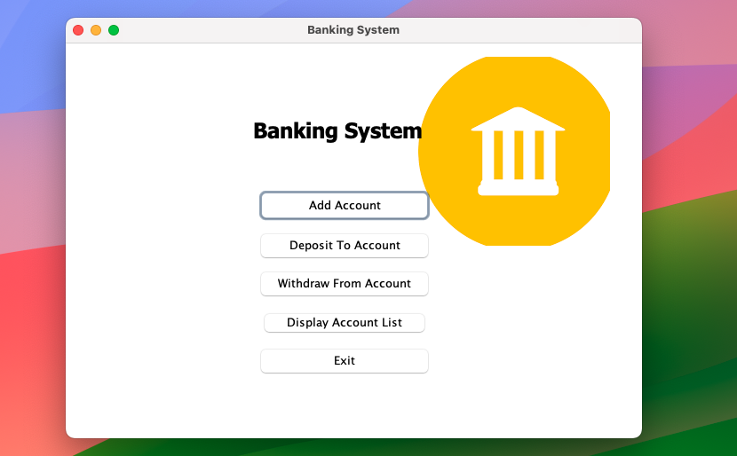

# Banking System - Java Swing Project

## Description
The Banking System is a Java Swing application that simulates basic banking operations. It provides a user-friendly interface for managing accounts, transactions, and other essential banking functions.

## Features
- Account creation and management
- Deposit and withdrawal transactions
- Balance inquiry
- Savings, Current and Student account types
- Searchable, sortable account list
- Data saved between runs (`data` file)
- User-friendly GUI with Java Swing

## Screenshots



## Technologies Used
- Java
- Java Swing for GUI
- HTML, CSS and JavaScript for the website, served by the JDK's built-in `com.sun.net.httpserver`
- [three.js](https://threejs.org) r160 for the 3D scenes (bundled in `web/vendor/three`, MIT licence, works offline)

## Installation
1. Clone the repository:
   ```bash
   git clone <repository-url>
   cd "java project"
   ```
2. Compile and run (Java 8+):
   ```bash
   javac -d bin $(find src -name '*.java') && cp -R src/img bin/
   java -cp bin Application
   ```
   Run it from the project folder so the `data` file is found. `bin` is build output and is not kept in git.
   In VS Code you can skip this: pick **Banking App (Swing)** or **Banking Website** in the Run and Debug panel.

## Website Version
The same banking system also runs as a website. It uses the same `Bank` classes and the same `data` file, and needs no extra libraries (the web server is the one built into the JDK, three.js is bundled).

**Easiest, in VS Code:** open `src/WebApplication.java` and click **Run** above `main`, or pick **Banking Website** in the Run and Debug panel. The browser opens by itself at http://localhost:8080. Log in with `admin` / `admin`.

**From a terminal**, in the project folder:
```bash
javac -d bin $(find src -name '*.java') && cp -R src/img bin/
java -cp bin WebApplication          # or: java -cp bin WebApplication 9000
```

Always open the site through the Java server (http://localhost:8080). Opening `index.html` directly or with VS Code's Live Server shows only an error, because those have no `/api`.

### What the website can do
- **Login** - an animated 3D bank card: it flies in, floats, flips to show its back, and can be dragged to spin or clicked to flip.
- **Dashboard** - total holdings, a 3D view with one tower per account (drag to turn, click to open), money in & out for the last 14 days, holdings by type and recent activity.
- **Accounts** - search, sort, filter by type and export to CSV. Each account has its own page with a card, its details, 5% interest projection for savings and student accounts, and its full history.
- **Deposit / Withdraw** - shows whose account it is and how much can be taken out while you type.
- **Transfer** - between any two accounts; the sender's minimum balance and withdraw limit apply.
- **Close account** - pays out the remaining balance; the account number is never reused.
- **Activity** - every transaction in the bank, filterable by kind.
- Quick account search in the top bar (press `/`), light and dark theme, works on phones.

Every deposit, withdrawal, transfer, opening and closing is recorded in the `data` file, including deposits and withdrawals made in the Swing app.

Don't run the Swing app and the website at the same time: each keeps its own copy of the accounts in memory and would overwrite the other's changes when it saves.

## Project Structure
- `src/Bank` - domain model: `Bank`, `BankAccount` and the Savings / Current / Student accounts, the `AccountType` enum and `Transaction` (the history). No GUI code.
- `src/Exceptions` - `AccNotFound`, `InvalidAmount`, `MaxBalance`, `MaxWithdraw`.
- `src/Data` - `FileIO`, saves and loads the bank (file `data`, created on first run).
- `src/GUI` - Swing windows. One `AccountForm` serves all account types and one `TransactionForm` serves deposit and withdraw, so a new account type only needs an `AccountType` entry and a `BankAccount` subclass.
- `src/Web` - `WebServer`, serves the `web` folder and a small JSON API (`/api/login`, `/api/bank`, `/api/accounts`, `/api/deposit`, `/api/withdraw`, `/api/transfer`, `/api/close`) over the same `Bank`. Started by `WebApplication`, which also opens the browser.
- `web` - the website: `index.html`, `style.css`, `app.js` (pages), `chart.js` (money in & out chart), `scene3d.js` (three.js scenes).

Accounts are kept in a map, so there is no limit on the number of accounts. Data is saved after every change.

## Usage
1. Launch the application.
2. Log in with username `admin` and password `admin`.
3. Use the menu to add accounts, deposit, withdraw and view the account list.

## Contribution
Contributions are welcome! If you'd like to contribute to the project, please follow these steps:

1. Fork the repository
2. Create a new branch (git checkout -b feature/new-feature)
3. Commit your changes (git commit -m 'Add new feature')
4. Push to the branch (git push origin feature/new-feature)
5. Create a pull request

## License
This project is for educational purposes.

## Acknowledgments
- Thanks to Java for the programming language.
- Special thanks to Java Swing for the GUI components.
